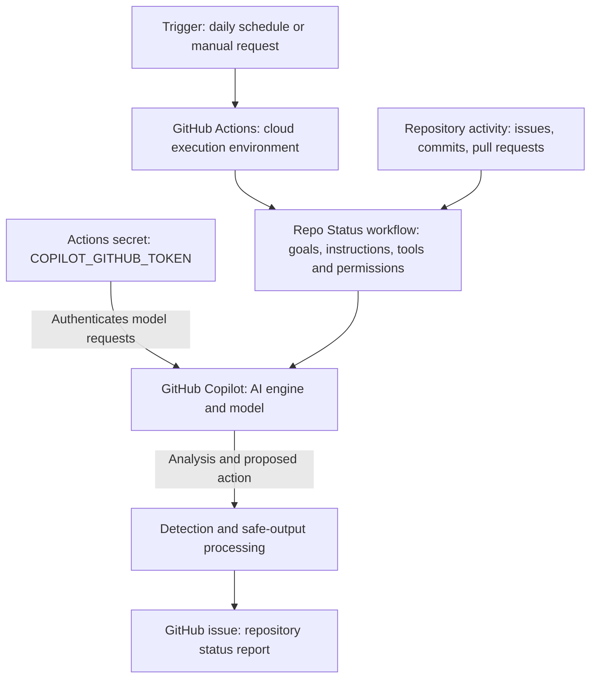

# Building and Deploying an Autonomous AI Agent with GitHub

A hands-on introduction to GitHub Agentic Workflows (`gh aw`) using GitHub Copilot and the prebuilt `repo-status` agent. These notes document the setup and troubleshooting performed on Windows with Git Bash for the `AgenticWorkflowRepo` project.

**Primary source:** [GitHub Agentic Workflows Quickstart](https://github.github.com/gh-aw/setup/quick-start/)

## 1. What are we building?

The Repo Status agent examines recent repository activity, summarizes progress, and recommends next steps. Its intended output is a GitHub issue. It can run on a daily schedule or be triggered manually, without the owner's computer being turned on.



The diagram shows the intended execution path, not a guarantee that an individual run succeeds. Detection and safe-output processing help constrain the actions an agent can take.

| Component | Responsibility |
| --- | --- |
| `git` | Local version control and synchronization with a remote repository |
| `gh` | Command-line access to GitHub services |
| `gh aw` | Extension for defining, compiling, deploying and inspecting agentic workflows |
| GitHub Actions | Runs the deployed workflow on GitHub-hosted infrastructure |
| GitHub Copilot | AI engine that provides access to underlying AI models |
| Personal access token (PAT) | Authorizes the workflow to make Copilot requests |
| Safe outputs | Mediate permitted changes, such as creating an issue |

## 2. Prerequisites and installation

- Git and a GitHub account.
- A GitHub repository with write access and Actions enabled under **Settings → Actions**.
- An active AI account. This example uses Copilot Pro; eligible educators and students can explore [GitHub Education](https://github.com/education). Verify the actual plan and usage limits before assigning this to a class.
- GitHub CLI (`gh`) version 2.0.0 or later, as specified in the quickstart.
- The official quickstart lists Linux, macOS and Windows with WSL. The Windows Git Bash workaround below was observed during this setup; it is not a guarantee of full native Windows support.

### Install GitHub CLI

On Windows, preferably from PowerShell:

```powershell
winget install --id GitHub.cli
```

Close and reopen your terminal, then check:

```bash
git --version
gh --version
```

Verify your Copilot subscription at [GitHub Copilot settings](https://github.com/settings/copilot). Our account showed Copilot Pro active.

### Authenticate GitHub CLI

```bash
gh auth status
gh auth login --scopes repo,workflow
```

Run the login command only if needed (or if the required scopes are missing). Choose GitHub.com, HTTPS and browser authentication. Follow the one-time code instructions and authorize the CLI. Then run `gh auth status` again.

Browser login does not automatically authenticate the CLI.

### Install the Agentic Workflows extension

```bash
gh extension install github/gh-aw
gh aw version
```

The [quickstart](https://github.github.com/gh-aw/setup/quick-start/) also provides an alternative installation script. Be aware that piping a downloaded script into Bash executes remote code immediately; inspect the source first.

## 3. Prepare a test repository

Use a dedicated repository rather than a production or course repository. For this example the target was `jillhubbard/AgenticWorkflowRepo`.

If you create a new repository on GitHub with a README, clone it:

```bash
gh repo clone YOUR_USERNAME/AgenticWorkflowRepo
cd AgenticWorkflowRepo
```

Replace `YOUR_USERNAME` with your GitHub login. Alternatively, if you already initialized a local repository and created an empty remote repository, ensure the local branch has a first commit and a remote before pushing:

```bash
git status
git remote -v
# Only if there is no README yet:
echo '# Agentic Workflow Repository' > README.md
git add README.md
git commit -m 'Initial commit'
git branch -M main
# Only if origin is not configured:
git remote add origin https://github.com/YOUR_USERNAME/AgenticWorkflowRepo.git
git push -u origin main
```

Do not overwrite an existing README or repeat the initial commit steps in an established repository. If the remote already contains commits, clone or synchronize it instead.

## 4. Configure Copilot authentication

The CLI login authorizes your local `gh` commands. The deployed workflow needs separate credentials for model inference.

For this personal Copilot subscription, use a [fine-grained personal access token](https://github.com/settings/personal-access-tokens/new):

1. Name the token (for example, `AgenticWorkflowCopilot`). Select a reasonable expiration and your personal account as resource owner.
2. Under **Account/User permissions**, select **Copilot Requests: Read**. Do not confuse this with the repository permission for reading Copilot agent settings and metadata.
3. Grant no additional repository permissions unless a documented requirement calls for them.
4. Generate the token and copy its value securely.
5. In the target repository, open **Settings → Secrets and variables → Actions → New repository secret**.
6. Name the secret exactly `COPILOT_GITHUB_TOKEN` and paste the token value. Save it.

Alternatively, from the repository root:

```bash
gh secret set COPILOT_GITHUB_TOKEN
gh secret list
```

Enter the token at the secure prompt. The list command confirms the secret name exists, not that its value or permissions are valid.

**Why Actions, not Agents?** This workflow is executed by GitHub Actions. The Agents secret store serves separate GitHub agent functionality. A secret in the wrong store will not satisfy the workflow's expected Actions credential.

Never commit the token, paste it into Markdown, share it with classmates, or include it in screenshots. If regenerated, replace the stored secret. If exposed, revoke it. For organization-billed Copilot workflows, a different authentication option exists; refer to the [authentication documentation](https://github.github.com/gh-aw/reference/auth/). This example uses the PAT option, not organization billing.

## 5. Install the Repo Status agent (one time)

Run from the root of your local Git repository:

```bash
gh aw add-wizard githubnext/agentics/repo-status
```

On Windows Git Bash, the wizard initially failed to recognize the terminal as interactive. This workaround successfully opened the wizard:

```bash
winpty gh aw add-wizard githubnext/agentics/repo-status
```

The shorthand identifies the source owner, repository and workflow name. The extension resolves it to a Markdown workflow in the source repository. The source is [githubnext/agentics/workflows/repo-status.md](https://github.com/githubnext/agentics/blob/main/workflows/repo-status.md).

### Wizard choices used in this example

| Prompt | Choice |
| --- | --- |
| Target repository | `jillhubbard/AgenticWorkflowRepo` (substitute your own) |
| AI engine | Copilot |
| Authentication | `COPILOT_GITHUB_TOKEN` |
| Schedule | Daily |
| Coding agent prompts and skills | Enabled |
| Delivery | Create a pull request |

Review the generated pull request in GitHub and merge it into `main`. Update your local checkout:

```bash
git switch main
git pull --ff-only
git status
```

### Files created

```text
.github/
  workflows/
    repo-status.md
    repo-status.lock.yml
  skills/agentic-workflows/SKILL.md   # optional authoring support
  agents/agentic-workflows.md        # optional authoring support
```

The `.md` file contains YAML frontmatter (triggers, permissions, tools and safe outputs) followed by natural-language instructions. The `.lock.yml` file is generated executable workflow configuration. Edit the Markdown source rather than manually editing generated YAML.

The installed workflow has daily and manual triggers, read access to repository contents/issues/pull requests, and a safe output that creates an issue with the `[repo-status]` prefix and report labels. It also allows closing older reports. Review those permissions before deploying.

## 6. Run the deployed agent

Installation is not execution. Once the workflow is on `main`, use this command whenever you want a new run:

```bash
gh aw run repo-status
```

Or open the repository's **Actions** tab, select **Repo Status**, and use **Run workflow** if available. Select `main` and confirm.

### Monitor the execution

Open **Actions → Repo Status → latest run**. Inspect the jobs:

| Job | Role |
| --- | --- |
| activation | Initialize the workflow |
| agent | Invoke the AI engine and perform the task |
| detection | Inspect execution/output for security concerns |
| safe_outputs | Process allowed output operations |
| conclusion | Finalize and report the outcome |

A green setup workflow does not mean the agent itself succeeded. Check the actual **Repo Status** run. After a successful run, check **Issues** for the report and inspect its accuracy.

## 7. Common commands

| Command | What it does |
| --- | --- |
| `gh aw version` | Show extension version |
| `gh aw --help` | List available commands |
| `gh aw doctor` | Check repository and authentication setup |
| `gh aw init` | Initialize repository support for agentic workflows |
| `gh aw add-wizard OWNER/REPO/NAME` | Install an existing workflow interactively |
| `gh aw add OWNER/REPO/NAME` | Import without the interactive wizard; configure as needed |
| `gh aw new` | Start a new custom workflow |
| `gh aw list` | List installed workflows |
| `gh aw status` | Check workflow state and recent results |
| `gh aw compile` | Regenerate workflow YAML from Markdown |
| `gh aw run repo-status` | Trigger the installed agent |
| `gh aw logs` | Summarize recent executions |
| `gh aw logs --artifacts all` | Retrieve detailed run artifacts |
| `gh aw audit RUN_ID` | Investigate a particular run |
| `gh aw audit RUN_ID --models` | Inspect recorded model discovery information |
| `gh run list` | List GitHub Actions runs and their IDs |
| `gh run view RUN_ID --log-failed` | Display failed job logs |
| `gh secret list` | List repository Actions secret names |

Replace `RUN_ID` with the numeric ID shown in the Actions run URL or `gh run list`. A run ID identifies an execution, not a branch or an agent definition. See the [CLI command reference](https://github.github.com/gh-aw/setup/cli/) for options; use `--help` on your installed version.

### Modify an existing agent

Edit `.github/workflows/repo-status.md`, then:

```bash
gh aw compile
git diff
git status
```

Review both the source and generated changes. Commit and push them (or open and merge a pull request), then trigger a new run. There is no need to re-import the original agent.

## 8. Gotchas encountered during setup

| Symptom | Explanation and next step |
| --- | --- |
| Windows installer abandoned; exit code `1618` | Another MSI installation was running. Check for permission dialogs; restart Windows if stuck. |
| `gh: command not found` but Winget says installed | Reopen Git Bash/VS Code to reload PATH. Check PowerShell and the installation directory if necessary. |
| `gh auth status` reports not logged in | Authenticate the CLI separately from browser login. |
| `add-wizard requires an interactive terminal` | Git Bash was not recognized as interactive. Prefix the wizard with `winpty`, or use a supported terminal/environment. |
| Wizard cannot determine target repository | Run from the repository root and check `git remote -v`. Enter `owner/repo` if asked. |
| `src refspec main does not match any` | The new local repository had no first commit (or the named branch did not exist). Check `git status` and commit before pushing. |
| Actions shows “Get started with GitHub Actions” | Confirm the generated `.lock.yml` is on the remote default branch and the installation PR has been merged. |
| Green setup workflows but red Repo Status run | Installation succeeded; actual agent execution failed. Inspect the agent job. |
| `catalog_unavailable`, zero tokens and zero turns | Model discovery failed before inference. Inspect provider authentication and same-run logs before changing model selection. |
| Token has no user permissions | The original PAT granted repository-level Copilot settings access, not user-level Copilot Requests. Correct the account permission to **Copilot Requests: Read**. |
| `Workflow from same source already exists, skipping` and `nothing added to commit` | The agent is already installed. Do not rerun the wizard just to execute or retry it. |
| Temporary `add-workflow-repo-status-*` branches | Choosing PR delivery creates a new branch for installation. Running the installed agent does not. |

### Initial failed run: diagnostic example

The initial run (`44948137839`) reached the agent job but failed during startup. The audit reported `catalog_unavailable`, no recorded model inventory for Copilot, zero inference turns and zero tokens. Detection also reported an internal failed step. No recorded firewall requests were blocked.

```bash
gh aw logs
gh aw logs --artifacts all
gh aw audit 44948137839
gh aw audit 44948137839 --models
gh run view 44948137839 --log-failed
```

To find the more detailed local error in Git Bash:

```bash
find .github/aw/logs/run-44948137839 -name 'agent-stdio.log'
```

The missing user-level Copilot permission is a strong candidate for the cause, but a successful execution after correction was not confirmed in the setup conversation. Verify the corrected permission, then run `gh aw run repo-status` and inspect the new run ID. Do not reinstall the agent.

### Clean up local branches and logs

After reviewing and merging installation PRs, switch to `main` and use `git branch -d BRANCH_NAME` to delete unneeded local branches. The lowercase `-d` checks for unmerged work. In this setup the temporary branches were removed and `git branch` showed only `main`.

Add this entry to `.gitignore` to avoid committing downloaded diagnostic artifacts:

```gitignore
.github/aw/logs/
```

Logs can contain sensitive operational data. Review and redact before sharing; never publish raw credentials.

## 9. Lessons for autonomous AI agents

- A model is only one component of an agent: the workflow supplies goals, triggers, tools and constraints.
- Model authentication is distinct from GitHub API authorization.
- A scheduled agent runs without a person initiating every task; the schedule and permitted outputs define the boundaries of that autonomy.
- Least privilege, safe outputs and execution logs are important safeguards, not proof of correctness.
- Monitor Actions minutes and AI usage separately; disable the workflow when classroom testing is complete if recurring reports are not needed.

## References

- [GitHub Agentic Workflows Quickstart](https://github.github.com/gh-aw/setup/quick-start/)
- [Repo Status source workflow](https://github.com/githubnext/agentics/blob/main/workflows/repo-status.md)
- [CLI commands](https://github.github.com/gh-aw/setup/cli/)
- [Authentication](https://github.github.com/gh-aw/reference/auth/)
- [Auditing workflows](https://github.github.com/gh-aw/reference/audit/)
- [GitHub CLI](https://cli.github.com/)
